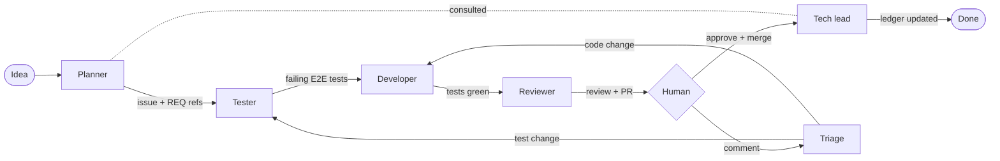

# Agent Workflow Plan

| Metadata | Value                                                                                                           |
| -------- | --------------------------------------------------------------------------------------------------------------- |
| Status   | Proposed                                                                                                        |
| Scope    | How features are planned, tested, built, reviewed and recorded                                                  |
| Audience | Humans and agents working on Tusch                                                                              |
| Decided  | Agents run both locally and on GitHub; E2E-only tests; committed visual baselines; Markdown requirements ledger |

## 1. Goal

Turn an idea into a merged, tested feature through a fixed pipeline of
specialised agents, with the human only at the start (the idea) and the end
(approve or comment on the PR). Each stage is visible on the issue through a
single `status:*` label.



## 2. Principles

- **One definition per role.** Each agent is a skill in `.claude/skills/<role>/SKILL.md`.
  The same skill runs locally (`/plan`, `/test 42`, `/develop 42`, …) and on
  GitHub (a workflow invokes it as the `prompt` of `claude-code-action`).
- **Labels are the state machine.** An issue has exactly one `status:*` label.
  An agent only picks up an issue whose label matches its role, and its last
  step swaps the label to the next state.
- **Tests define done.** The tester writes the E2E tests first; the developer is
  done only when those tests and the full suite pass.
- **E2E is the only test layer.** Goal: every feature in the requirements ledger
  has at least one E2E test that proves it. No new unit/component tests.
- **Requirements are explicit.** `docs/requirements.md` is the ledger of how
  the app must behave; plans reference it, PRs update it.
- **Visual changes are reviewable.** Every view has a committed screenshot
  baseline; a PR that changes UI changes the image, and GitHub shows the diff.
- **No stacked PRs.** Every branch starts from `main`; one issue, one branch,
  one PR. (Stacked PRs merged top-down never reached `main` once already.)

## 3. Roles

| Role      | Skill        | Trigger (GitHub)                              | Output                                                                                                   | Next label                                 |
| --------- | ------------ | --------------------------------------------- | -------------------------------------------------------------------------------------------------------- | ------------------------------------------ |
| Planner   | `/plan`      | `status:idea` label, or replies on that issue | Asks clarifying questions, then writes the ticket (template §6) with REQ references                      | `status:needs-tests`                       |
| Tester    | `/test`      | `status:needs-tests`                          | Branch `issue-<n>` from `main` with **failing** E2E tests tagged with REQ ids; comment listing them      | `status:needs-dev`                         |
| Developer | `/develop`   | `status:needs-dev`                            | Implementation on the same branch; ticket tests + full suite green; screenshot baselines updated         | `status:needs-review`                      |
| Reviewer  | `/review`    | `status:needs-review`                         | Reviews against rules + ledger; opens the PR with summary, REQ list and inline comments; may bounce back | `status:needs-human`                       |
| Triage    | `/triage`    | Human review comment / "changes requested"    | Decides whether the comment needs test or code changes and routes it                                     | `status:needs-tests` or `status:needs-dev` |
| Tech lead | `/tech-lead` | Consulted by planner; PR merged; weekly       | Adds, edits, removes requirements; audits that every REQ has an E2E test                                 | —                                          |

Locally, the human can run any skill on any issue at any time (e.g. take over
development by hand); the skill still finishes by setting the next label.

## 4. Labels

| Label                                      | Meaning                                                                |
| ------------------------------------------ | ---------------------------------------------------------------------- |
| `status:idea`                              | Raw idea; planner is asking questions on the issue                     |
| `status:needs-tests`                       | Ticket is ready; tester writes failing E2E tests                       |
| `status:needs-dev`                         | Tests exist and fail; developer implements                             |
| `status:needs-review`                      | Tests pass; reviewer reviews and opens the PR                          |
| `status:needs-human`                       | PR open, waiting for approval or comments                              |
| `status:blocked`                           | An agent gave up (turn/time cap, ambiguity, failing CI); needs a human |
| `type:feature` / `type:bug` / `type:chore` | Kind of work; bugs start with a reproducing E2E test                   |

Rules: one `status:*` at a time; agents never skip a state; a failed agent run
sets `status:blocked` and comments why.

## 5. Artifacts

### 5.1 Agent rules

`CLAUDE.md` stays short and points to topic rule files in `docs/rules/`,
derived from the current code:

- `architecture.md`: module layout and dependency rules (features, contracts,
  client state, workflows, server, route groups).
- `code-style.md`: Zod-first types (from `AGENTS.md`), naming, comments, errors.
- `forms.md`: native forms, contracts, `enhanceAction` / `enhanceClientCommand`.
- `testing.md`: E2E only; page objects; `gotoHydrated`; mock gateway and
  `mock-error:<kind>`; REQ tags; screenshots.
- `workflow.md`: labels, branches, PR format, when to stop and set `status:blocked`.

### 5.2 Requirements ledger

`docs/requirements.md`, one entry per requirement:

```md
### REQ-012 Captions can be added to a panel

- Status: active
- Statement: A user can add a caption to any panel; it is persisted locally and survives reload.
- Why: …
- Proven by: `add caption` (src/routes/(local)/comic/[id]/[panel]/test/page.svelte.e2e.ts)
```

- E2E tests carry the id as a Playwright tag (`{ tag: '@REQ-012' }`).
- A CI check fails if an active REQ has no tagged test, or a test tags an
  unknown REQ.
- Obsolete requirements are deleted (git history keeps them), not marked dead.

### 5.3 Screenshots

- `e2e/screenshots.e2e.ts` visits every view (landing, create, comic, panel,
  raw, settings, plus empty and 404 states) and calls `toHaveScreenshot()`.
- Baselines are committed and generated **on Linux only**, via the Playwright
  Docker image, so local macOS runs and CI agree.
- Deterministic: mock gateway, seeded examples, animations off, fixed viewport.
- `pnpm screenshots:update` regenerates baselines; the developer agent runs it
  when a UI change is intended.

### 5.4 Ticket template (planner output)

```md
## Problem / idea

## Requirements

- REQ-007 (existing), REQ-NEW: <statement> ← proposed by the tech lead

## Acceptance criteria (each becomes an E2E test)

- [ ] Given … when … then …

## Views affected (screenshots expected to change)

## Out of scope
```

## 6. Orchestration on GitHub

- `.github/workflows/agents.yml`: on `issues: labeled`, run the skill that
  matches the new label; on `pull_request_review` / PR comments from a human,
  run `/triage`; on PR merged, run `/tech-lead`.
- `allowed_bots: claude`, so a label set by an agent can trigger the next stage
  (the action ignores bot events by default).
- `concurrency: agent-issue-<n>`: one agent per issue at a time.
- Per role: `--max-turns` and `timeout-minutes`; on failure a step sets
  `status:blocked`.
- The existing `@claude` workflow stays for ad-hoc requests; the automatic
  `claude-code-review.yml` is removed (the reviewer role replaces it).

## 7. Work packages

| WP   | Work                                                                                 | Depends on |
| ---- | ------------------------------------------------------------------------------------ | ---------- |
| AW0  | Repo guardrails: labels, auto-delete branches, branch protection, remove auto-review | —          |
| AW1  | Spike: agent label hand-off and PR creation on GitHub                                | AW0        |
| AW2  | Agent rules derived from the current code (`docs/rules/`)                            | —          |
| AW3  | Requirements ledger seeded from the current app, plus REQ↔test CI check              | AW2        |
| AW4  | E2E coverage for every REQ                                                           | AW3        |
| AW5  | Remove unit/component tests and Vitest                                               | AW4        |
| AW6  | Screenshot baselines for every view                                                  | AW2        |
| AW7  | Skills: `/plan`, `/test`, `/develop`, `/review`, `/triage`, `/tech-lead`             | AW2, AW3   |
| AW8  | `agents.yml` orchestration                                                           | AW1, AW7   |
| AW10 | Accessibility: axe scan on every view, fail on serious/critical (#37)                | AW6        |
| AW11 | Release notes in every PR, collected in `CHANGELOG.md` (#39)                         | AW7        |
| AW12 | Vercel preview links to affected views in the reviewer's PR summary (#40)            | AW7        |
| AW13 | Weekly tech-lead audit: stale REQs, flaky tests, stuck issues (#38)                  | AW8        |
| AW9  | Pilot one small feature end to end; fix what breaks; document                        | all        |

## 8. Risks

- **Bot-triggered events.** If label hand-off by `claude[bot]` cannot trigger
  workflows, AW8 falls back to one workflow that runs the next stage directly
  after the previous one. AW1 decides this before AW8 starts.
- **PR creation from Actions.** `mcp__github__create_pull_request` did not load
  in the current workflow; AW1 must prove a working path (e.g. `gh pr create`
  with the app token) or the reviewer posts a "Create PR" link.
- **Screenshot flakiness.** Mitigated by Linux-only baselines and determinism;
  any flaky view is masked or removed, not retried.
- **Cost.** Caps per role, one agent per issue, and a WIP limit (at most two
  issues past `status:needs-tests` at once).
