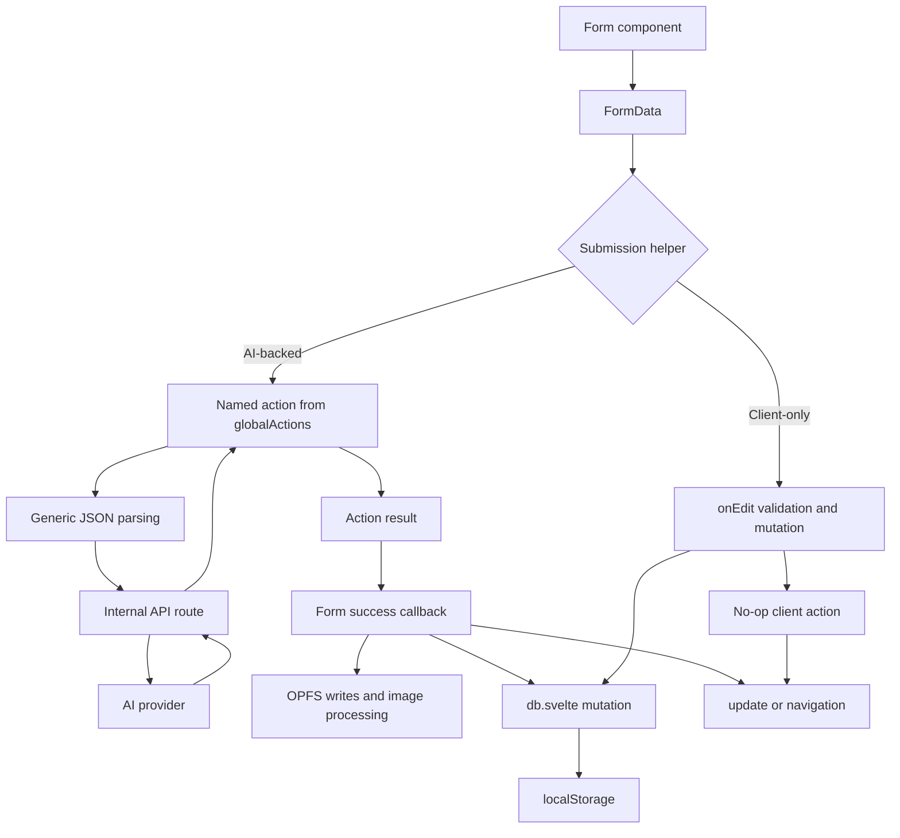
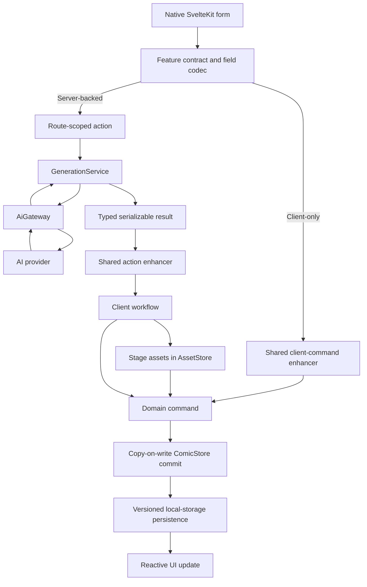

# Data Flow Refactor Plan

| Metadata     | Value                                                                           |
| ------------ | ------------------------------------------------------------------------------- |
| Status       | Proposed                                                                        |
| Scope        | Data flow only                                                                  |
| Audience     | Implementation agents and reviewers                                             |
| Architecture | SvelteKit, Svelte 5, Zod, browser-local persistence                             |
| Primary goal | Make functionality easier to add without replacing the established form pattern |

## 1. Objective

Refactor the app toward a predictable, feature-owned data flow while preserving its local-first architecture and existing SvelteKit form pattern.

The desired flow is:

1. A native form expresses user intent.
2. A feature contract explicitly decodes and validates its fields.
3. A route-scoped action performs server work when needed.
4. A shared enhancer handles submission lifecycle.
5. A client workflow applies side effects.
6. A domain command commits one aggregate update.
7. Persistence stores the resulting snapshot.

The result should make a feature independently understandable and changeable without modifying central dispatchers, generic parsers, or unrelated forms.

## 2. Non-negotiable constraints

- Keep native SvelteKit forms:

  ```svelte
  <form method="POST" action="?/action-name" use:enhance={handleSubmit}>
  ```

- Continue using SvelteKit named actions and progressive enhancement.
- Do not introduce a form library.
- Do not introduce a state-management library.
- Prefer plain TypeScript functions, Svelte runes, and the existing Zod dependency.
- Keep comics local-first:
  - Comic metadata is client-owned.
  - Comic metadata is persisted to `localStorage`.
  - Image blobs are stored in OPFS.
- Keep credentials server-owned through cookies.
- Make selected model cookies the single authority for server model configuration.
- Implement incrementally, one work package at a time.
- Preserve current behavior unless correcting a contract bug explicitly listed in this document.
- Do not combine this work with UI, styling, accessibility, spelling, or broad naming cleanup.
- Do not add abstraction interfaces unless they create a real boundary or support an immediate testing need.
- Server code must not import from `src/lib/components` or browser-only `.svelte.ts` modules.
- Components must not perform persistence, asset-storage, or multi-step application orchestration after the migration.

## 3. Current state

### 3.1 Current sources of truth

| Data                       | Current authority                             | Persistence                | Notes                                           |
| -------------------------- | --------------------------------------------- | -------------------------- | ----------------------------------------------- |
| Comics, panels, characters | `COMIC_DB` in `src/lib/utils/db/db.svelte.ts` | `localStorage`             | Client-authoritative                            |
| Image blobs                | Browser OPFS                                  | OPFS                       | Metadata stores file names                      |
| API key                    | Cookie                                        | Cookie                     | Set before validation in the current BYOK flow  |
| Selected models            | `CONFIG_DB` and cookies                       | `localStorage` and cookies | Competing authorities                           |
| Action result              | SvelteKit action response                     | None                       | Transient                                       |
| Loading state              | `globalLoading`                               | None                       | Boolean state is unsafe for concurrent requests |
| Error state                | `globalError`                                 | None                       | Shared errors can overwrite each other          |

### 3.2 Current flow



### 3.3 Main problems and root causes

#### `db.svelte.ts` has too many responsibilities

`src/lib/utils/db/db.svelte.ts` currently owns:

- Browser detection.
- Initial hydration.
- Demo/example seeding.
- Reactive state.
- Local-storage persistence.
- Comic queries.
- Comic mutations.
- Configuration state.
- Configuration persistence.
- Generic edit dispatch.
- Generic delete dispatch.

This makes persistence, domain behavior, and reactivity inseparable.

Nested objects are often mutated in place. Reactivity can therefore depend on a later route `update()` rather than a clear store commit.

#### Forms own application workflows

Examples include:

- `src/lib/components/forms/createComicForm/CreateComicForm.svelte`
- `src/lib/components/forms/createCoverImageForm/CreateCoverImageForm.svelte`
- `src/lib/components/forms/createPanelImageForm/CreatePanelImageForm.svelte`

These components currently perform combinations of:

- OPFS writes.
- Base64 conversion.
- Image cropping.
- ID generation.
- Comic-store mutation.
- Character-image mutation.
- Route invalidation.
- Navigation.

A form component should describe fields and connect a result to an application workflow. It should not implement the workflow.

#### Dependency direction is inverted

`src/lib/utils/actions/actions.ts` imports form decoding from:

```text
src/lib/components/forms/utils/values.ts
```

Server action code must not depend on the component layer.

In the other direction, forms import:

- Server action result types.
- Database functions.
- Storage functions.
- Crop functions.
- ID generation.

Shared contracts should sit between client and server instead.

#### Submission behavior is split

AI-backed forms use:

```text
server action → action result → client mutation
```

Client-only forms use:

```text
client mutation → no-op server action → update
```

The different lifecycle and commit timing make failures and new operations harder to reason about.

#### Form decoding is overly generic

`src/lib/utils/actions/utils/postAiResponse.ts` attempts `JSON.parse` on every string.

This can unintentionally convert valid user input:

- `"123"` into a number.
- `"false"` into a boolean.
- `"null"` into `null`.
- JSON-looking instructions into objects or arrays.

Only fields declared as JSON should be parsed as JSON.

#### Actions are globally exposed

`src/lib/utils/actions/actions.ts` exports `globalActions`, and examined `+page.server.ts` files export the full map.

Consequences:

- Every route depends on every action.
- A new action changes a central registry.
- Pages expose actions they do not use.
- Feature ownership is obscured.

#### Excessive aggregate data is submitted

Some forms serialize entire comics, panel collections, characters, or panels into hidden fields.

The server cannot read browser-local state, so some context must be submitted. However, it should be a minimal prompt DTO rather than a mutable domain aggregate containing unrelated data and asset references.

#### Assets and metadata are not committed as one workflow

OPFS and `localStorage` cannot participate in a true browser transaction.

Current image flows can leave:

- Partially written metadata.
- Missing character crops.
- Orphaned files.
- Old files after replacement.
- Metadata pointing to unavailable assets.

The workflow should stage assets first, commit metadata last, and clean up staged files on failure.

### 3.4 Known contract issues to stabilize

The following are in scope because they directly affect data flow:

- Native checkbox values such as `"on"` do not match boolean schemas.
- Image-reference fields are produced by image actions but dropped by `src/routes/api/ai/utils/post.ts`.
- `fetchPanel()` currently points to the cover-image endpoint.
- Upstream `response.ok` is not checked before parsing a response.
- Expected validation failures become HTTP 500 errors instead of `fail(400, ...)`.
- Model configuration is committed to client state before the cookie action succeeds.
- BYOK stores the candidate API-key cookie before validating the key.
- Empty configuration state conflicts with the required configuration type in `db.svelte.ts`.
- The panel route loader can return `{}` despite declaring a complete page-data type.

## 4. Target architecture

### 4.1 Target sources of truth

| Data                           | Target authority                            |
| ------------------------------ | ------------------------------------------- |
| Comic metadata                 | Client `ComicStore`                         |
| Persisted comic snapshot       | Versioned local-storage adapter             |
| Image blobs                    | `AssetStore`, initially backed by OPFS      |
| API key                        | HTTP-only server cookie                     |
| Selected models                | Server cookies                              |
| Safe selected-model projection | Settings load/action data                   |
| Form input contract            | Feature-owned Zod schema and explicit codec |
| Submission status              | Shared enhancer lifecycle                   |
| AI interaction                 | `GenerationService` and `AiGateway`         |

### 4.2 Target flow



### 4.3 Dependency rules

#### Components

Components may depend on:

- Feature contracts.
- Shared form enhancers.
- Display components.
- Small navigation callbacks.
- Typed props.

Components must not depend directly on:

- Local-storage adapters.
- OPFS implementations.
- Crop orchestration.
- Database internals.
- Server implementation modules.

#### Shared contracts

Contracts may depend on:

- Zod.
- Shared domain schemas.
- Pure form-field codec helpers.

Contracts must not depend on:

- Svelte components.
- Browser storage.
- Svelte reactive state.
- AI provider SDKs.
- Route files.

#### Client workflows

Client workflows may depend on:

- Shared contracts.
- Domain commands.
- Domain selectors.
- `AssetStore`.
- Image/crop utilities where required.

They must not render UI or know about Svelte components.

#### Domain commands and selectors

Commands and selectors may depend on:

- Domain types.
- The comic store.
- Persistence ports/adapters.

They must not know about forms, routes, AI providers, or SvelteKit action results.

#### Server actions

Server actions may depend on:

- Shared contracts.
- Server application services.
- SvelteKit request/action APIs.

They must not import from `src/lib/components`, client stores, OPFS, or browser-only modules.

#### AI services

`GenerationService` owns application-level generation operations.

`AiGateway` owns provider interaction.

Provider-specific code remains behind the gateway.

If `/api/ai/*` routes remain public, the routes and SvelteKit actions must call the same service. Actions must not call the app’s own API through an in-process HTTP request.

## 5. Proposed module layout

Exact names may be adjusted to existing conventions, but ownership boundaries must remain.

```text
src/lib/
  features/
    comics/
      contracts/
        create-comic.ts
        create-cover-image.ts
        delete-comic.ts
      client/
        comic-store.svelte.ts
        comic-commands.ts
        comic-selectors.ts
        comic-persistence.ts
        bootstrap.ts
        workflows/
          commit-generated-comic.ts
          commit-generated-cover.ts

    panels/
      contracts/
        create-panel.ts
        create-panel-image.ts
        edit-caption.ts
        delete-panel.ts
      client/
        workflows/
          commit-generated-panel.ts
          commit-generated-panel-image.ts
          create-character-crop.ts

    settings/
      contracts/
        save-model-settings.ts
        validate-api-key.ts

  forms/
    enhance-action.ts
    enhance-client-command.ts
    form-data.ts
    form-errors.ts
    submission-state.svelte.ts

  client/
    assets/
      asset-store.ts
      opfs-asset-store.ts

  server/
    features/
      comics/
        actions/
          create-comic.ts
          create-cover-image.ts
        generation-service.ts
      panels/
        actions/
          create-panel.ts
          create-panel-image.ts
        generation-service.ts
      settings/
        actions/
          save-model-settings.ts
          validate-api-key.ts

    ai/
      ai-gateway.ts
      openai-gateway.ts
```

Do not create empty abstraction layers in advance. Introduce each module when its first consumer is migrated.

## 6. Work packages

Each work package should be independently reviewable and leave the application in a usable state.

---

## WP0 — Characterization and contract stabilization

**Dependencies:** None

### Goal

Document current behavior with tests and correct known data-flow contract bugs before structural movement.

### Steps

- [ ] Add tests for native `FormData` behavior:
  - Checkbox present and absent.
  - Numeric-looking text.
  - Boolean-looking text.
  - `null`-looking text.
  - Declared JSON fields.
  - Malformed declared JSON fields.
- [ ] Add tests for `onSubmit`:
  - Success.
  - Action failure.
  - Server error.
  - Client success callback throwing.
  - Loading cleanup in every path.
- [ ] Add tests for `onEdit`:
  - Valid input.
  - Invalid input.
  - Action failure.
  - Update callback failure.
  - Mutation timing.
- [ ] Replace expected validation errors with `fail(400, structuredFailure)`.
- [ ] Check `response.ok` before reading provider/API success data.
- [ ] Ensure provider errors retain an actionable status and message.
- [ ] Decode native checkbox values explicitly.
- [ ] Forward image-reference fields through `src/routes/api/ai/utils/post.ts`.
- [ ] Correct the endpoint used by `fetchPanel()`.
- [ ] Add action-to-endpoint tests that assert:
  - Endpoint path.
  - HTTP method.
  - Request body.
  - Optional image-reference forwarding.
- [ ] Record existing unrelated diagnostics separately rather than fixing them in this work package.

### Structured failure shape

Use a consistent shape for expected failures:

```ts
type FormFailure = {
	code: string;
	message: string;
	fieldErrors?: Record<string, string[]>;
	retryable?: boolean;
};
```

Exact naming may vary, but expected validation and provider failures must not be represented only as unstructured exceptions.

### Tests

- [ ] Contract-level unit tests.
- [ ] Action tests.
- [ ] API adapter tests.
- [ ] Submission-helper tests.
- [ ] Existing relevant form tests.

### Acceptance criteria

- [ ] Text fields are never implicitly JSON-coerced.
- [ ] Checkboxes decode correctly.
- [ ] Reference-image data reaches the AI adapter.
- [ ] `fetchPanel()` uses the panel endpoint.
- [ ] Validation failures use `fail(400, ...)`.
- [ ] Non-success upstream responses are handled before success parsing.
- [ ] Existing intended form behavior remains unchanged.
- [ ] No architectural file movement is mixed into this package.

---

## WP1 — Feature-owned form contracts

**Dependencies:** WP0

### Goal

Give every operation one shared, explicit contract that can be used by forms, client workflows, actions, and tests.

### Steps

- [ ] Create reusable, explicit field readers in `src/lib/forms/form-data.ts`, such as:
  - `readString`
  - `readOptionalString`
  - `readInteger`
  - `readCheckbox`
  - `readJsonField`
- [ ] Do not create a helper that attempts JSON parsing on every field.
- [ ] Move decoding responsibility out of:
  - `src/lib/components/forms/utils/values.ts`
  - `src/lib/utils/actions/utils/postAiResponse.ts`
- [ ] Create a contract module per operation.
- [ ] Each contract should own:
  - Input schema.
  - Explicit `FormData` decoder.
  - Output type or schema.
  - Action name or action-name association.
  - Failure type.
  - Optional hidden-field encoder.
- [ ] Move action result types out of server implementation modules so forms can import shared types without depending on server code.
- [ ] Remove the import from `actions.ts` into the component layer.
- [ ] Define minimal AI prompt-context DTOs.

### Minimum prompt-context DTOs

#### Create panel

Include only data needed to establish continuity:

- Comic ID for client correlation.
- Target insertion index.
- Existing panel prompt context.
- Necessary character IDs and dialogue context.

Exclude image blobs and unnecessary asset metadata.

#### Create cover

Include only data used by the cover prompt:

- Comic ID.
- Style.
- Character descriptions.
- Panel narrative context.

Exclude stored image file names and generated image assets unless explicitly required.

#### Create panel image

Include only:

- Comic ID.
- Panel ID.
- Panel visual/narrative prompt context.
- Relevant characters.
- Style.
- User instructions.
- Optional reference-image data.

### Tests

- [ ] One decoder test file per feature contract.
- [ ] Present and missing optional fields.
- [ ] Malformed JSON only for declared JSON fields.
- [ ] Checkbox behavior.
- [ ] Numeric index coercion.
- [ ] Minimal DTO tests proving asset data is omitted.
- [ ] Shared contract types compile in both client and server consumers.

### Acceptance criteria

- [ ] Server action code has no imports from `src/lib/components`.
- [ ] Forms no longer import result types from server implementation modules.
- [ ] Generic whole-form JSON parsing is no longer used by migrated actions.
- [ ] Every migrated form field has an explicit decoding rule.
- [ ] AI requests use purpose-specific prompt DTOs rather than full mutable aggregates.

---

## WP2 — Unified form enhancement

**Dependencies:** WP1

### Goal

Give server-backed and client-only forms a consistent submission lifecycle without changing the native form pattern.

### Target helpers

```text
enhanceAction(contract, onSuccess)
enhanceClientCommand(contract, command)
```

Names may change, but the responsibilities must stay distinct and explicit.

### Steps

- [ ] Add `src/lib/forms/enhance-action.ts`.
- [ ] Add `src/lib/forms/enhance-client-command.ts`.
- [ ] Centralize:
  - Loading lifecycle.
  - Error normalization.
  - Expected action failures.
  - Unexpected client-workflow errors.
  - Optional form reset.
  - Optional route invalidation.
  - Duplicate-submit protection.
- [ ] Replace the global loading boolean with a request counter or equivalent concurrency-safe implementation.
- [ ] Preserve the existing global loader UI through an adapter if necessary.
- [ ] Keep structured failures available for future form-scoped rendering.
- [ ] For client-only forms:
  - Decode before submission.
  - Do not mutate when decoding fails.
  - Commit only after the `?/client` action succeeds during the migration.
- [ ] Pilot the server-backed helper on:
  - `src/lib/components/forms/createPanelForm/CreatePanelForm.svelte`
- [ ] Pilot the client-command helper on:
  - `src/lib/components/forms/editTextFieldForm/EditTextFieldForm.svelte`
- [ ] Preserve existing form markup and action names during the pilot.
- [ ] Keep compatibility wrappers for unmigrated forms until all consumers move.

### Tests

- [ ] Loading starts and stops exactly once.
- [ ] Concurrent submissions do not hide the global loader prematurely.
- [ ] Validation failure does not execute a command.
- [ ] Action failure does not execute a client workflow.
- [ ] A thrown client workflow error is surfaced and loading stops.
- [ ] Successful client command runs once.
- [ ] Duplicate submissions cannot produce duplicate commits.
- [ ] Existing component interaction tests continue to pass.

### Acceptance criteria

- [ ] The pilot forms keep native `<form>` and `use:enhance`.
- [ ] Both pilot flows use shared lifecycle handling.
- [ ] Client mutation no longer happens before a successful action result.
- [ ] Components do not manually manipulate global loading/error state.
- [ ] Existing route behavior is preserved.

---

## WP3 — Split the client database

**Dependencies:** WP2

### Goal

Separate reactive state, domain commands, selectors, bootstrap, and persistence while preserving the current local-first behavior.

### Steps

- [ ] Extract reactive comic state into `comic-store.svelte.ts`.
- [ ] Extract read operations into `comic-selectors.ts`.
- [ ] Extract explicit mutations into `comic-commands.ts`.
- [ ] Extract persistence into `comic-persistence.ts`.
- [ ] Move initial loading and example seeding into an explicit `bootstrap.ts`.
- [ ] Remove example seeding as a module-import side effect.
- [ ] Define a versioned persisted snapshot:

  ```ts
  {
    version: number;
    comics: Comic[];
  }
  ```

- [ ] Validate persisted snapshots with Zod.
- [ ] Define behavior for:
  - Missing storage.
  - Empty storage.
  - Corrupt JSON.
  - Unsupported versions.
  - Invalid comic data.
  - Storage quota failures.
- [ ] Use copy-on-write aggregate updates.
- [ ] Ensure one domain command produces:
  - One reactive store replacement.
  - One persistence write.
- [ ] Replace generic operations with explicit commands:
  - `addComic`
  - `deleteComic`
  - `insertPanel`
  - `deletePanel`
  - `replaceCover`
  - `removeCover`
  - `replacePanelImage`
  - `removePanelImage`
  - `editCaption`
  - `deleteCaption`
  - `editDialogue`
  - `deleteDialogue`
  - `addCharacterImage`
  - `removeCharacterImage`
- [ ] Return typed failures or results for missing IDs and invalid indexes.
- [ ] Move configuration out of the comic database boundary.
- [ ] Keep a temporary compatibility facade if needed for incremental migration.
- [ ] Remove the facade after all callers use commands/selectors directly.

### Command rules

- Commands express user or workflow intent.
- Commands do not inspect form data.
- Commands do not call SvelteKit APIs.
- Commands do not perform navigation.
- Commands do not write image blobs.
- Commands commit complete aggregate replacements.
- Commands persist only after producing valid next state.

### Tests

- [ ] Every command has focused unit tests.
- [ ] Missing comic, panel, character, and image IDs.
- [ ] Invalid insertion and deletion indexes.
- [ ] Nested changes trigger reactive updates.
- [ ] Exactly one persistence write per command.
- [ ] Snapshot validation.
- [ ] Snapshot migration.
- [ ] Empty state.
- [ ] Corrupt state.
- [ ] Explicit example bootstrap.
- [ ] Storage write failure does not silently report success.

### Acceptance criteria

- [ ] `db.svelte.ts` no longer mixes all current responsibilities.
- [ ] No command depends on route invalidation to make a nested mutation visible.
- [ ] Generic `editType` and `deleteType` switches are removed from migrated code.
- [ ] Persistence is versioned and validated.
- [ ] Example data is initialized explicitly.
- [ ] Configuration is no longer stored in the comic database module.

---

## WP4 — Extract client workflows and asset transactions

**Dependencies:** WP3

### Goal

Move multi-step post-action orchestration out of form components and make asset-plus-metadata operations recoverable.

### Target workflows

- [ ] `commitGeneratedComic`
- [ ] `commitGeneratedCover`
- [ ] `insertGeneratedPanel`
- [ ] `commitGeneratedPanelImage`
- [ ] `createCharacterCrop`

### Asset boundary

Introduce an `AssetStore` abstraction only to separate workflows from OPFS and enable failure testing.

Expected operations:

```ts
interface AssetStore {
	put(blob: Blob, preferredName?: string): Promise<string>;
	readUrl(assetId: string): Promise<string>;
	delete(assetId: string): Promise<void>;
}
```

Adjust the interface if required by the browser APIs, but keep OPFS details out of workflows and components.

### Workflow rules

For asset-generating operations:

1. Validate the action result.
2. Stage all required files.
3. Track every staged asset ID.
4. Build final metadata.
5. Commit metadata once through a domain command.
6. Delete staged files if any pre-commit step fails.
7. After successful replacement, remove obsolete files when safe.
8. Surface cleanup failures separately from the primary commit result.

### Migration order

Migrate simpler flows before the panel-image workflow:

1. `CreatePanelForm`
2. `CreateCoverImageForm`
3. `CreateComicForm`
4. `CreateCharacterImageForm`
5. `CreatePanelImageForm` last

The panel-image workflow is last because it coordinates:

- Main panel image.
- Head crops.
- Full-body crops.
- Multiple character records.
- Multiple OPFS writes.
- One comic aggregate update.

### Steps

- [ ] Move storage and crop orchestration into workflow modules.
- [ ] Remove direct database imports from migrated form components.
- [ ] Remove direct storage imports from migrated form components.
- [ ] Remove direct crop and ID generation imports from migrated form components.
- [ ] Consolidate the duplicated panel-image generation logic currently represented in the form and its utility module.
- [ ] Keep navigation as a small component/route callback after workflow success.
- [ ] Add replacement cleanup for old cover and panel assets.
- [ ] Add deletion cleanup where the corresponding domain item owns an asset.

### Tests

Use an in-memory or fake `AssetStore` with failure injection.

- [ ] Failure before the first write.
- [ ] Failure after the main image write.
- [ ] Failure during a character crop.
- [ ] Failure during a later character write.
- [ ] Failure before metadata commit.
- [ ] Domain commit failure after staging.
- [ ] Successful rollback deletes all staged assets.
- [ ] Successful replacement removes obsolete assets.
- [ ] Metadata never references an asset that failed to persist.
- [ ] Workflow success commits metadata exactly once.

### Acceptance criteria

- [ ] Migrated forms contain no persistence or image-processing orchestration.
- [ ] One workflow is the canonical implementation of panel-image processing.
- [ ] Metadata is committed only after required assets are available.
- [ ] Failed workflows do not leave committed partial metadata.
- [ ] Staged assets are cleaned up on failure where possible.

---

## WP5 — Server services and route-scoped actions

**Dependencies:** WP1; preferably WP2 before migrating all forms

### Goal

Remove the internal action-to-API HTTP hop and make action ownership explicit per route.

### Steps

- [ ] Introduce `GenerationService` operations:
  - `createComic`
  - `createPanel`
  - `createCoverImage`
  - `createPanelImage`
- [ ] Introduce an `AiGateway`.
- [ ] Move OpenAI-specific interaction behind an `OpenAiGateway`.
- [ ] Have SvelteKit actions call `GenerationService` directly.
- [ ] If `/api/ai/*` endpoints remain necessary, make them call the same services.
- [ ] Remove action calls to the app’s own API through `event.fetch`.
- [ ] Reduce or retire `src/lib/utils/actions/utils/postAiResponse.ts`.
- [ ] Export action handlers individually.
- [ ] Replace `globalActions` with route-scoped action maps.

### Expected route ownership

The exact map must follow the forms rendered on each route.

#### `/`

Expected actions:

- Client command/no-op action used by comic deletion during migration.

#### `/comic/create`

Expected actions:

- Create comic.

#### `/comic/[id]`

Expected actions may include:

- Create cover image.
- Client commands for cover/panel/comic operations.
- Client-only character crop operation during migration.

#### `/comic/[id]/[panel]`

Expected actions may include:

- Create panel.
- Create panel image.
- Client commands for text and image edits/deletes.

#### `/settings`

Expected actions:

- Validate/store API key.
- Save model configuration.

### Error handling

- Expected input failures use `fail(400, ...)`.
- Provider authentication failure uses an appropriate non-500 status.
- Provider rate limiting remains identifiable and retryable.
- Unexpected provider failures use an actionable server error.
- Successful action payloads contain only serializable data.

### Tests

- [ ] `GenerationService` tests using a fake gateway.
- [ ] Gateway adapter tests.
- [ ] Action contract tests.
- [ ] API route tests if API routes remain.
- [ ] Route action-map tests or compile-time checks.
- [ ] Tests proving a route cannot invoke unrelated actions.
- [ ] Tests proving action logic does not make an internal HTTP request.

### Acceptance criteria

- [ ] Actions call application services directly.
- [ ] Provider-specific code is behind `AiGateway`.
- [ ] `globalActions` is removed.
- [ ] Every route exposes only the actions it needs.
- [ ] Server action modules do not import components or client state.
- [ ] API routes, if retained, do not duplicate generation logic.

---

## WP6 — Route boundary and settings ownership

**Dependencies:** WP3 and WP5

### Goal

Make browser-only state, missing entities, credentials, and selected-model ownership explicit.

### Steps

- [ ] Establish one browser-only boundary for routes that read local comic state.
- [ ] Prefer a layout or route group over repeated `export const ssr = false`.
- [ ] Verify that server actions continue to operate correctly within that boundary.
- [ ] Update route loaders to use domain selectors.
- [ ] Return complete page data or throw/return an explicit not-found result.
- [ ] Remove loaders that declare a complete type but return `{}`.
- [ ] Define direct-navigation behavior for:
  - Missing comic.
  - Missing panel.
  - Panel not belonging to comic.
  - Empty comic collection.
- [ ] Make selected-model cookies the only persisted model authority.
- [ ] Remove `CONFIG_DB` and its local-storage persistence.
- [ ] Return safe selected-model values through settings load/action data.
- [ ] Never expose the API key through page data.
- [ ] Change BYOK flow to:
  1. Read candidate key.
  2. Validate candidate through the gateway.
  3. Set the HTTP-only cookie only after validation succeeds.
- [ ] Make model-setting updates atomic from the UI perspective:
  1. Submit selected models.
  2. Validate.
  3. Write cookies.
  4. Return committed safe settings.
  5. Update UI from successful action/load data.

### Tests

- [ ] Direct navigation to an existing local comic.
- [ ] Direct navigation to a missing comic.
- [ ] Direct navigation to a missing panel.
- [ ] Reload after creating a comic.
- [ ] Empty-state navigation.
- [ ] Successful API-key validation stores a cookie.
- [ ] Failed API-key validation does not store or retain the candidate cookie.
- [ ] Successful model update writes both model cookies.
- [ ] Failed model update leaves previous settings unchanged.
- [ ] Settings UI reflects cookie-backed values.
- [ ] API key is absent from page data and browser-readable state.

### Acceptance criteria

- [ ] The browser-only boundary is declared once.
- [ ] Route data types match every possible loader result.
- [ ] Missing entities are handled explicitly.
- [ ] Model configuration has one persisted authority.
- [ ] Invalid API keys are never committed as the active credential.
- [ ] Data-flow-related diagnostics in the affected routes and config modules are resolved.

---

## WP7 — Extensibility proof

**Dependencies:** WP1 through WP6

### Goal

Prove that a small feature can be implemented as a vertical slice without changing central parsers, action registries, or generic database switches.

### Preferred proof feature

Add an “add caption” operation.

If adding product functionality is not desired, use an existing caption operation and document the same dependency constraints.

### Steps for an add-caption proof

- [ ] Add an `AddCaption` contract.
- [ ] Add an explicit `addCaption` domain command.
- [ ] Add or extend a native SvelteKit form.
- [ ] Connect it through `enhanceClientCommand`.
- [ ] Add focused contract, command, and component tests.
- [ ] Add relevant E2E coverage.
- [ ] Record all files changed.

### Expected change set

The feature should require changes only in:

- Its feature contract.
- Its domain command.
- Its form/component integration.
- Focused tests.
- A route action map only if server work is required.

It must not require changes to:

- A global action registry.
- A generic form parser.
- A generic edit/delete switch.
- OPFS internals.
- Unrelated forms.
- Unrelated routes.

### Acceptance criteria

- [ ] The feature works through the established native form pattern.
- [ ] No central dispatcher or broad switch is introduced.
- [ ] No unrelated feature files are changed.
- [ ] The implementation demonstrates the intended extension path.
- [ ] The changed-file list is documented in the PR summary.

## 7. Migration matrix

| Current location                                | Current responsibility                                    | Target location/responsibility                                                |
| ----------------------------------------------- | --------------------------------------------------------- | ----------------------------------------------------------------------------- |
| `src/lib/utils/db/db.svelte.ts`                 | Store, persistence, queries, commands, config, bootstrap  | Split into comic store, selectors, commands, persistence, and bootstrap       |
| `src/lib/utils/db/dbTypes.ts`                   | Mixed database and form-operation types                   | Domain schemas remain with domain; operation inputs move to feature contracts |
| `src/lib/components/forms/utils/values.ts`      | FormData decoding                                         | Feature-owned contract codecs                                                 |
| `src/lib/utils/actions/onSubmit.ts`             | Server-action enhancement                                 | `src/lib/forms/enhance-action.ts`                                             |
| `src/lib/utils/actions/onEdit.ts`               | Client parsing, mutation, action lifecycle                | `src/lib/forms/enhance-client-command.ts` plus explicit commands              |
| `src/lib/utils/actions/actions.ts`              | Global action registry                                    | Individual action handlers and route-scoped maps                              |
| `src/lib/utils/actions/utils/postAiResponse.ts` | Generic parsing and internal API requests                 | Explicit codecs plus direct `GenerationService` calls                         |
| `src/lib/utils/storage/storage.ts`              | Raw OPFS access                                           | OPFS-backed `AssetStore`                                                      |
| `CreateComicForm.svelte`                        | Fields, asset persistence, database commit, navigation    | Fields plus enhancer and small navigation callback                            |
| `CreateCoverImageForm.svelte`                   | Fields, image loading, asset persistence, database commit | Fields plus cover workflow                                                    |
| `CreatePanelImageForm.svelte`                   | Fields and full panel/character image workflow            | Fields plus panel-image workflow                                              |
| `createPanelImageForm/utils/generateImages.ts`  | Duplicate/partial image workflow                          | Consolidated canonical workflow                                               |
| `CreatePanelForm.svelte`                        | Fields and direct database commit                         | Fields plus action enhancer and panel workflow                                |
| `EditTextFieldForm.svelte`                      | Fields, parsing, direct mutation, lifecycle               | Fields plus client-command enhancer                                           |
| Route `+page.ts` files                          | Direct database reads and partial data                    | Typed selectors and explicit missing-entity behavior                          |
| Route `+page.server.ts` files                   | Export all global actions                                 | Export only route-owned actions                                               |
| Settings `CONFIG_DB`                            | Client model configuration authority                      | Remove; use cookie-backed safe load/action data                               |
| `src/routes/api/ai/utils/post.ts`               | Provider adapter with incomplete request forwarding       | Shared service/gateway adapter or removed internal hop                        |

## 8. Test strategy

### Contract tests

Test every feature contract independently:

- Valid fields.
- Missing required fields.
- Optional fields.
- Native checkbox values.
- Number parsing.
- Declared JSON parsing.
- Malformed declared JSON.
- Structured validation failures.

### Store and command tests

Test:

- Successful aggregate updates.
- Missing IDs.
- Invalid indexes.
- Immutability/copy-on-write behavior.
- Reactive updates.
- Exactly one persistence write.
- No persistence on failed command.

### Persistence tests

Test:

- Empty state.
- Valid snapshot.
- Corrupt JSON.
- Invalid schema.
- Unsupported version.
- Migration.
- Quota/write failures.
- Explicit example bootstrap.

### Workflow tests

Use fake asset and command dependencies.

Test:

- Success.
- Failure at each side-effect boundary.
- Asset rollback.
- Metadata commit ordering.
- Replacement cleanup.
- No partial aggregate commit.

### Server tests

Test:

- Action decoding.
- Service invocation.
- Gateway request shape.
- Provider failures.
- Authentication failure.
- Rate limiting.
- Route-scoped action availability.
- No internal self-fetch.

### Component tests

Keep component tests focused on:

- Form fields.
- Labels.
- Hidden-field output.
- Edit/cancel behavior.
- Correct action URL.
- Correct enhancer connection.
- Success UI or navigation callback.

Do not retest domain command internals through component tests.

### E2E tests

Prioritize:

- Create comic.
- Reload and reopen comic.
- Add panel.
- Generate/replace panel image.
- Edit/delete caption or dialogue.
- Save model settings.
- Invalid and valid API key.
- Missing comic/panel navigation.
- Double-submit prevention.

## 9. Global definition of done

- [ ] Native SvelteKit forms and `use:enhance` remain the standard.
- [ ] No new form or state-management library is introduced.
- [ ] Server modules do not import from `src/lib/components`.
- [ ] Server modules do not import client `.svelte.ts` state.
- [ ] Migrated forms do not perform persistence or asset orchestration.
- [ ] Every migrated form field has explicit decoding rules.
- [ ] Generic whole-form JSON coercion is removed.
- [ ] Expected validation errors use structured `fail(400, ...)`.
- [ ] Provider response status is checked.
- [ ] Client commands use copy-on-write aggregate commits.
- [ ] One logical command results in one persistence write.
- [ ] Persisted comic snapshots are versioned and validated.
- [ ] Demo/example initialization is explicit.
- [ ] Asset workflows stage files before committing metadata.
- [ ] Failed asset workflows clean up staged files where possible.
- [ ] Actions call services directly rather than the app’s own API.
- [ ] Routes expose only the actions they use.
- [ ] Browser-only route behavior is declared once.
- [ ] Missing comics and panels are handled explicitly.
- [ ] Cookies are the single authority for selected models.
- [ ] API keys are validated before being committed.
- [ ] A small feature can be added without editing central dispatchers or switches.
- [ ] Targeted tests, type checks, and relevant E2E tests pass.
- [ ] Pre-existing unrelated failures are reported separately.

## 10. Agent execution protocol

Implementation agents must follow this protocol.

### Before starting a work package

1. Read this document completely.
2. Confirm all dependency work packages are complete.
3. Inspect the current implementations and relevant tests.
4. Record relevant existing diagnostics and test failures.
5. Identify the smallest independently reviewable change set.

### During implementation

- Work on one work package at a time.
- Do not mix unrelated cleanup into the change.
- Preserve behavior unless correcting a listed contract bug.
- Keep compatibility adapters when needed for incremental migration.
- Remove compatibility adapters only after all consumers have moved.
- Prefer existing dependencies and project conventions.
- Do not add comments that merely restate code.
- Do not commit or create branches unless explicitly requested.
- Do not silently change data ownership.
- Stop and request a decision if implementation reveals a conflict with the ownership model in this document.

### Validation order

Run the most focused validation first:

1. Tests for the changed contract, command, workflow, or component.
2. Related route/action tests.
3. Type and Svelte checks:

   ```sh
   npm run check
   ```

4. Unit tests:

   ```sh
   npm run test:unit -- --run
   ```

5. Relevant Playwright tests when available.

Run the full E2E suite only when the scope and environment make that appropriate.

### Reporting

Every completed work package must report:

- Files changed.
- Responsibilities moved.
- Behavior intentionally changed.
- Compatibility code added or removed.
- Tests run and results.
- Remaining diagnostics.
- Pre-existing failures, listed separately.
- Follow-up work that belongs to a later work package.

## 11. Deferred work

The following work is intentionally outside this plan unless required to complete a data-flow migration:

- UI redesign.
- Styling cleanup.
- Layout changes.
- Accessibility cleanup.
- Copy and localization cleanup.
- Spelling and naming corrections such as:
  - `charachter`
  - `genereate`
- Broad component reorganization unrelated to data flow.
- AI provider replacement.
- Model-selection redesign.
- Prompt-quality redesign.
- Backend database introduction.
- Authentication/account systems.
- Cloud synchronization.
- Multi-user collaboration.
- Cross-device asset storage.
- Broad test-suite cleanup unrelated to touched behavior.
- General performance optimization without measured need.
- Replacing SvelteKit forms with client-only event handlers.

These should be planned separately after the data-flow boundaries are stable.
